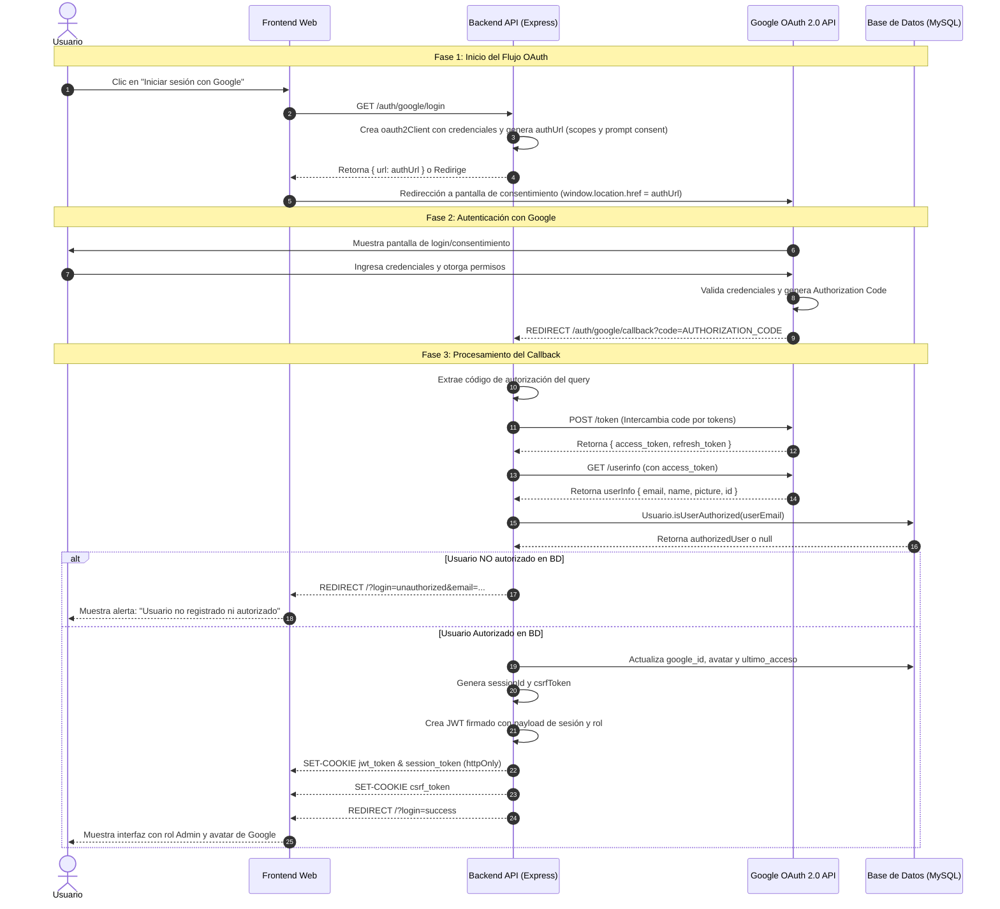

# Práctica: REST API - Perfiles de Jugadores y Rosters (eSports)
> **Branch `google-auth`**: Implementación de Autenticación con Google OAuth 2.0 y Tabla de Usuarios Registrados en MySQL.

Esta es una práctica para la materia de Desarrollo de Aplicaciones Web. Desarrollamos una API RESTful para la gestión de jugadores y armado de rosters en equipos de eSports, utilizando Node.js, Express, Sequelize ORM y MySQL.

---

## Ultima actualizacion en Branch `google-auth` (Meta 4.1)

En esta entrega se implementan los siguientes requerimientos de la Unidad 4:
1. **Autenticación con Google OAuth 2.0:**
   - Ruta `GET /auth/google/login`: Genera la URL de autorización con Google OAuth 2.0 (scopes de email y perfil, `prompt: consent`, acceso `offline`).
   - Ruta `GET /auth/google/callback`: Recibe el código de autorización de Google, intercambia el código por tokens de acceso (`oauth2Client.getToken`), obtiene el perfil (`google.oauth2.userinfo.get`), y valida la autorización contra la base de datos MySQL.
2. **Tabla de Usuarios Registrados en el Backend (`usuarios`):**
   - Migración de Sequelize `migrations/20261029170001-create-usuarios.cjs` y modelo `src/models/usuario.model.js`.
   - Consulta `Usuario.isUserAuthorized(userEmail)`: Si el usuario está registrado y autorizado en la base de datos, emite la sesión con JWT en cookie HTTP-Only (`jwt_token` y `session_token`), cookie de token CSRF (`csrf_token`), y redirige a `/?login=success`.
   - Si el usuario **NO** está registrado o autorizado, se rechaza la sesión y redirige a `/?login=unauthorized`.
3. **Soporte HTTPS en Backend (Unidad 4):**
   - El servidor levanta HTTP en el puerto `3000` y de forma segura HTTPS en el puerto `5000` utilizando certificados SSL/TLS (`cert/cert.pem` y `cert/key.pem`).
4. **Integración con Frontend Web:**
   - Botón directo de "Iniciar sesión con Google OAuth 2.0" en el modal de inicio de sesión.
   - Manejo reactivo de parámetros `?login=success` y `?login=unauthorized` con notificaciones visuales y visualización del avatar y nombre del usuario de Google.

---

## Diagrama de Secuencia: Flujo Google OAuth 2.0



---

## Stack Tecnológico

- **Backend:** Node.js (con módulos ES6), Express y HTTPS nativo
- **OAuth 2.0:** `googleapis` (^166.0.0)
- **ORM / Modelos:** Sequelize v6
- **Base de Datos:** MySQL 8
- **Frontend:** HTML5, CSS3 moderno (tema eSports responsivo) y JavaScript vanilla (SPA)
- **Documentación:** OpenAPI 3.0 con Swagger UI (`swagger-ui-express`)
- **Seguridad y Autorización:** Google OAuth 2.0, JWT en cookies HTTP-Only, Doble Cookie Pattern para CSRF, validación de API Key y control de roles
- **Control de Versiones:** Git (Branch `google-auth`)

---

## Tabla de Usuarios Registrados (`usuarios`)

La tabla `usuarios` almacena y controla el acceso autorizado al sistema:

| Campo | Tipo | Descripción |
|---|---|---|
| `id` | `INT` PK AUTO_INCREMENT | Identificador único del usuario |
| `google_id` | `VARCHAR(255)` UNIQUE NULL | ID único provisto por Google OAuth al autenticarse |
| `email` | `VARCHAR(255)` UNIQUE NOT NULL | Correo electrónico institucional o personal registrado |
| `nombre` | `VARCHAR(255)` NULL | Nombre completo del usuario |
| `avatar` | `VARCHAR(500)` NULL | URL de la foto de perfil retornada por Google |
| `rol` | `VARCHAR(255)` NOT NULL | Rol asignado (`Admin` o `Usuario`) |
| `autorizado` | `BOOLEAN` NOT NULL | `true` si el usuario tiene permiso para acceder |
| `ultimo_acceso` | `DATETIME` NULL | Timestamp del último inicio de sesión exitoso |
| `created_at` | `DATETIME` NOT NULL | Fecha de creación del registro |
| `updated_at` | `DATETIME` NOT NULL | Fecha de última modificación |

### Usuarios Autorizados Iniciales (Seed)
Al iniciar la aplicación, se asegura la existencia de los siguientes usuarios:
- `admin@esports.com` (Rol: Admin)
- `orduna.juan@uabc.edu.mx` (Rol: Admin)
- `molguin@uabc.edu.mx` (Rol: Admin)

---

## Variables de Entorno (`.env`)

Crea un archivo `.env` en la raíz del proyecto basándote en `.env.example`:

```env
PORT=3000
HTTPS_PORT=5000
DB_HOST=127.0.0.1
DB_PORT=3306
DB_NAME=esports_db
DB_USER=backenduser
DB_PASSWORD=superpassword

# Configuración de JWT y Cookies
JWT_SECRET=super_secreto_para_jwt_esports_2026
JWT_EXPIRES_IN=2h
API_KEY=esports_api_key_secret_2026
COOKIE_MAX_AGE=7200000

# Credenciales de Administrador para pruebas tradicionales
ADMIN_EMAIL=admin@esports.com
ADMIN_PASSWORD=admin123

# Configuración de Google OAuth 2.0
GOOGLE_CLIENT_ID=tu_google_client_id_aqui
GOOGLE_CLIENT_SECRET=tu_google_client_secret_aqui
GOOGLE_REDIRECT_URI=http://localhost:3000/auth/google/callback
```

### Configuración en Google Cloud Console:
1. Ir a [Google Cloud Console](https://console.cloud.google.com/).
2. Crear o seleccionar un proyecto.
3. En **APIs y Servicios** > **Pantalla de consentimiento de OAuth**: Seleccionar tipo Externo y completar los datos básicos.
4. En **Credenciales**: Crear credencial de tipo **ID de cliente de OAuth**.
   - Tipo de aplicación: *Aplicación web*.
   - **Orígenes de JavaScript autorizados**: `http://localhost:3000` y `https://localhost:5000`.
   - **URI de redirección autorizados**: `http://localhost:3000/auth/google/callback` y `https://localhost:5000/auth/google/callback`.
5. Copiar el *Client ID* y *Client Secret* a tu archivo `.env`.

---

## Instalación y Ejecución

### 1. Clonar el repositorio y cambiarse a la rama `google-auth`
```bash
git clone https://github.com/JuanOrd04/Esport_Web.git
cd Esport_Web
git checkout google-auth
npm install
```

### 2. Ejecutar las migraciones de Base de Datos
```bash
npm run migrate
```

### 3. Iniciar el servidor
```bash
npm start
# O en modo desarrollo con auto-reload:
npm run dev
```

El servidor estará disponible en:
- **HTTP**: `http://localhost:3000`
- **HTTPS Seguro**: `https://localhost:5000`
- **Documentación Swagger UI**: `http://localhost:3000/api-docs`

---

## Endpoints Disponibles

### Autenticación con Google OAuth 2.0 y Sesiones

| Método | Endpoint | Descripción | Acceso |
|---|---|---|---|
| `GET` | `/auth/google/login` | Inicia el flujo OAuth y genera URL de consentimiento | Público |
| `GET` | `/auth/google/callback` | Callback de Google, valida usuario en BD y emite cookies | Público |
| `POST` | `/api/v1/auth/login` | Login tradicional con email y contraseña | Público |
| `POST` | `/api/v1/auth/logout` | Cierre de sesión y limpieza de cookies | Público |
| `GET` | `/api/v1/auth/verify` | Valida el estado de autenticación y datos del usuario | Requiere JWT y CSRF |
| `GET` | `/api/v1/auth/usuarios` | Consulta la lista de usuarios registrados en MySQL | Requiere Admin |
| `POST` | `/api/v1/auth/usuarios` | Registra/autoriza un nuevo usuario en la base de datos | Requiere Admin |

### Gestión de Jugadores y Rosters

| Método | Endpoint | Descripción | Acceso |
|---|---|---|---|
| `GET` | `/api/v1/jugadores` | Listado de jugadores con filtros | Público |
| `GET` | `/api/v1/jugadores/:id` | Detalle de un jugador | Público |
| `POST` | `/api/v1/jugadores` | Crear nuevo jugador | Requiere Admin |
| `PUT` | `/api/v1/jugadores/:id` | Actualizar jugador existente | Requiere Admin |
| `DELETE` | `/api/v1/jugadores/:id` | Eliminar jugador | Requiere Admin |
| `GET` | `/api/v1/rosters` | Listado de rosters | Público |
| `GET` | `/api/v1/rosters/:id` | Detalle de roster con titulares y suplentes | Público |
| `POST` | `/api/v1/rosters` | Crear nuevo roster | Requiere Admin |
| `PUT` | `/api/v1/rosters/:id` | Actualizar información del roster | Requiere Admin |
| `DELETE` | `/api/v1/rosters/:id` | Eliminar roster | Requiere Admin |
| `POST` | `/api/v1/rosters/:id/jugadores` | Asignar jugador a roster (RN-01 a RN-04) | Requiere Admin |
| `PUT` | `/api/v1/rosters/:id/jugadores/:idJugador` | Cambiar rol en roster (Titular/Suplente) | Requiere Admin |
| `DELETE` | `/api/v1/rosters/:id/jugadores/:idJugador` | Remover asignación de jugador (RN-05) | Requiere Admin |
| `GET` | `/api/v1/health` | Estado del servidor y conexión con MySQL | Público |

---

## Pruebas Automatizadas con REST Client
Se incluye el archivo interactivo `test-collection.http` con casos de prueba para:
- Flujo de Google OAuth (`/auth/google/login` y `/auth/google/callback`).
- Verificación de usuario autorizado y no autorizado contra la tabla `usuarios`.
- Pruebas completas de las reglas de negocio RN-01 a RN-05.
